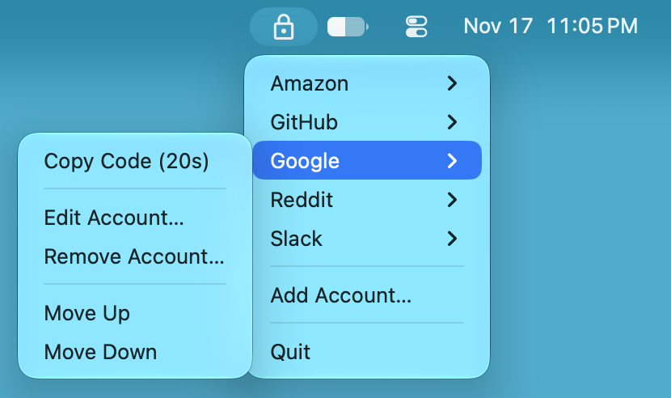
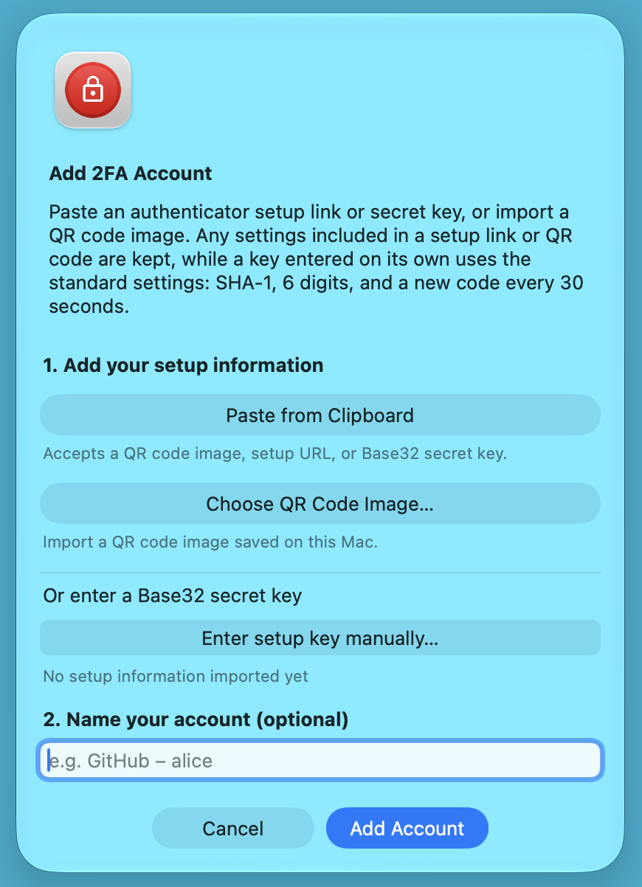

# Menu Bar 2FA

A lightweight macOS menu bar app for generating and copying time-based one-time passwords (TOTP). Account secrets are stored locally in the macOS Keychain.

# Screenshots




## Features

- Add, rename, remove, and reorder multiple accounts.
- Copy a current code directly from an account's menu.
- Import setup information from the clipboard or a QR code image, or enter a Base32 secret key manually.
- Support SHA-1, SHA-256, and SHA-512; 6- or 8-digit codes; and custom positive time periods.
- Read QR codes locally. Setup information is never sent to a server.

## Add an account

1. Start authenticator-app setup on the service's website.
2. Choose **Add Account…** from the Menu Bar 2FA menu.
3. Choose **Paste from Clipboard** to import a setup URL, QR code image, or Base32 secret key. You can also choose **Choose QR Code Image…** to import a saved image. To capture a QR code displayed on your Mac, press **Control–Shift–Command–4**, select the code, then paste it into the app.
4. To type a Base32 secret key instead, choose **Enter setup key manually…** and enter the key.

When available, the service's issuer is used as the default account name. Otherwise, the app assigns a name such as **Account 1**. You can rename an account at any time.

Settings included in a setup URL or QR code are preserved. A Base32 key entered on its own uses the standard settings: SHA-1, 6 digits, and a 30-second period. Only standard `otpauth://totp/` setup codes are supported; HOTP and proprietary authenticator-app transfer QR codes are not.

Keep each service's recovery codes somewhere safe. Accounts are stored in this Mac's Keychain and aren't synced between Macs by the app.

## Use the menu

Click the lock icon in the menu bar to see your accounts. Open an account to find **Copy Code**, **Edit Account**, **Remove Account**, and the options to move it up or down in the list.

## Install

Download the latest release from the [GitHub releases page](https://github.com/scottmangiapane/menu-bar-2fa/releases), unzip it, and move **Menu Bar 2FA.app** to your Applications folder.

Releases are signed with an **Apple Development** certificate, but aren't signed with **Developer ID** or notarized. This is sufficient for development, but downloaded releases may still trigger Gatekeeper warnings. If macOS blocks the app on first launch, go to **System Settings > Privacy & Security** and click **Open Anyway**.

## Start at login

Open **System Settings > General > Login Items & Extensions**. Under **Open at Login**, click **+** and add **Menu Bar 2FA**.

## Build a GitHub release

1. Open `Menu Bar 2FA.xcodeproj` in Xcode.
2. Select the **Menu Bar 2FA** scheme and **Any Mac** as the destination.
3. Choose **Product > Archive**.
4. In Organizer, select the new archive and choose **Distribute App > Custom > Copy App**. Export the app.
5. In Terminal, run this from the folder containing `Menu Bar 2FA.app` to create a ZIP that preserves the app bundle:

   ```sh
   ditto -c -k --sequesterRsrc --keepParent \
     "Menu Bar 2FA.app" "Menu Bar 2FA.zip"
   ```

6. Upload `Menu Bar 2FA.zip` to the GitHub release.

The exported app retains its **Apple Development** signature. You can inspect and verify it with:

```sh
codesign -dv --verbose=4 "Menu Bar 2FA.app" 2>&1
codesign --verify --deep --strict --verbose=2 "Menu Bar 2FA.app"
```

This workflow does not notarize the app. Developer ID signing and notarization require paid Apple Developer Program membership.

## Compatibility

Requires macOS 12 or later. The project supports both Apple Silicon and Intel Macs.
